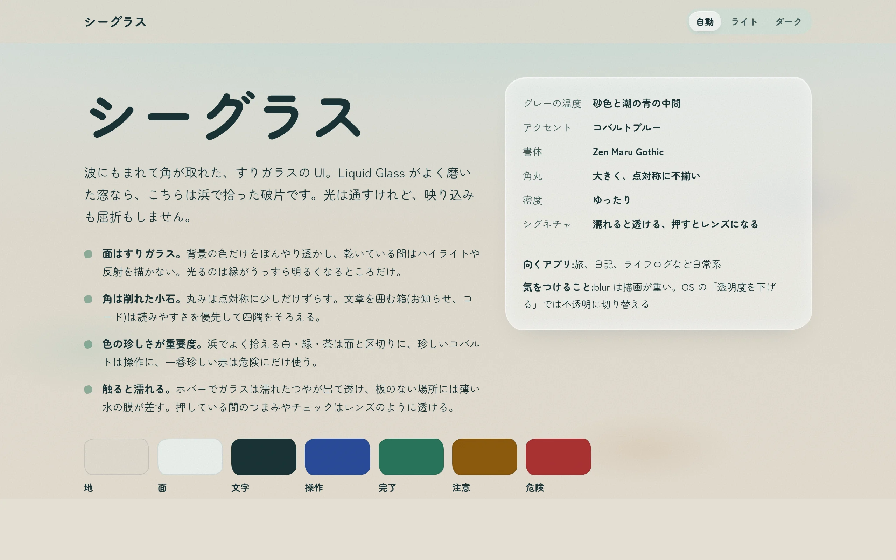
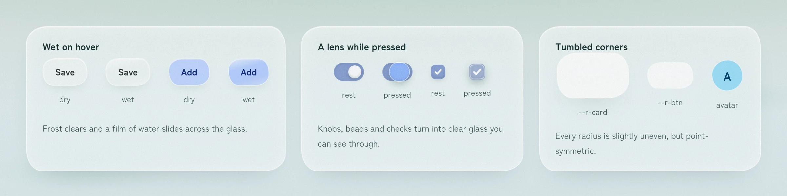
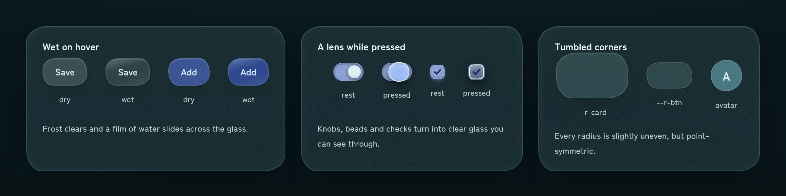
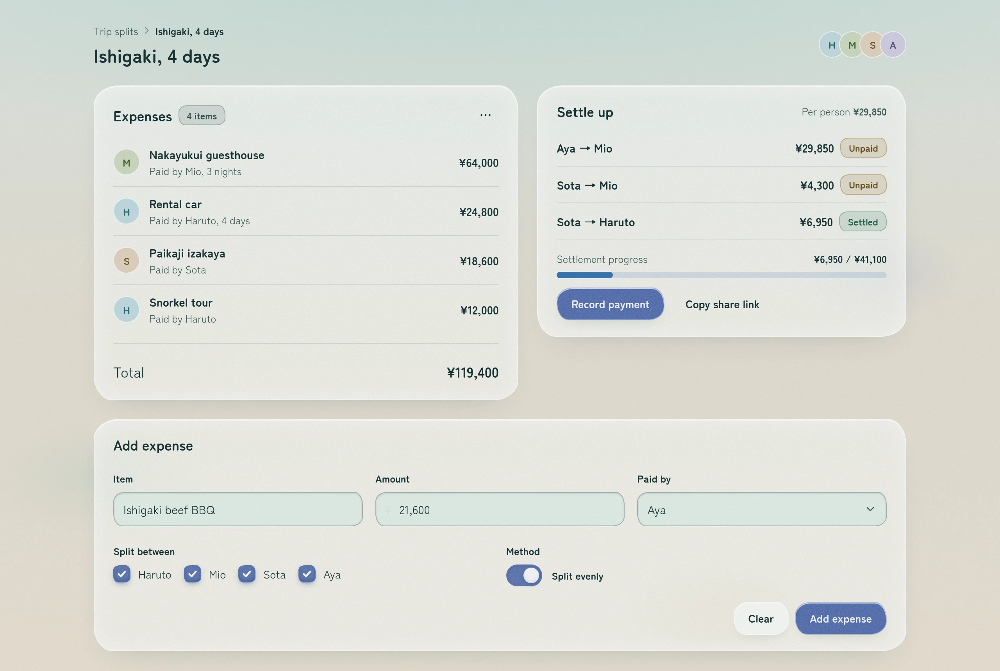
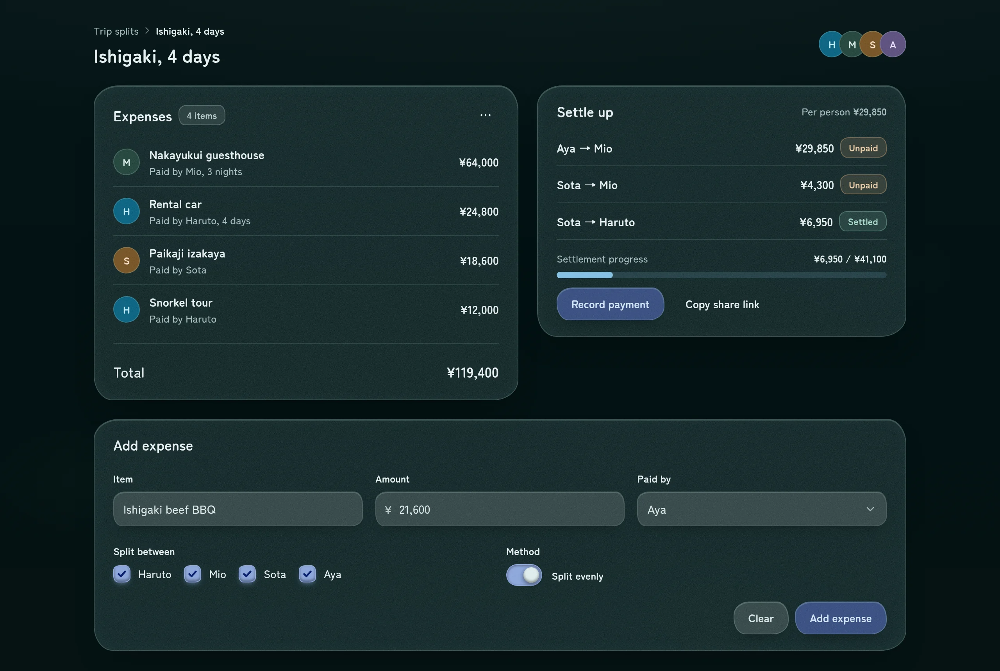
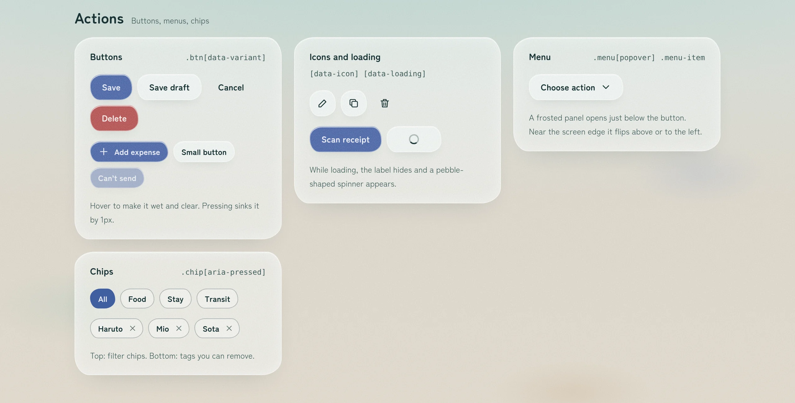
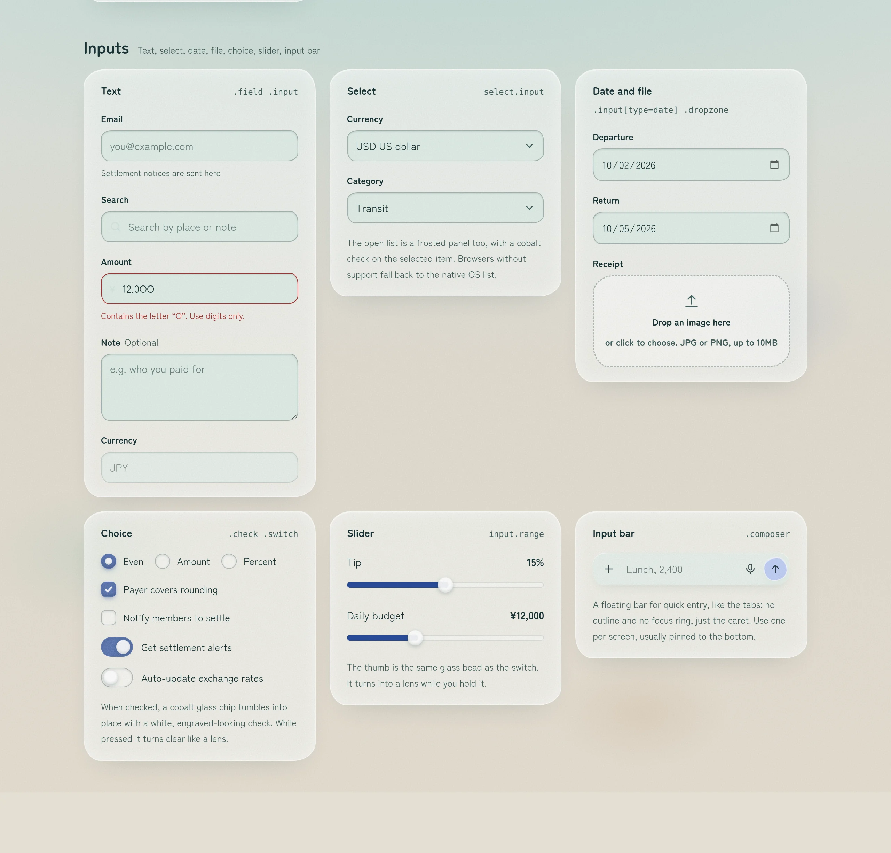
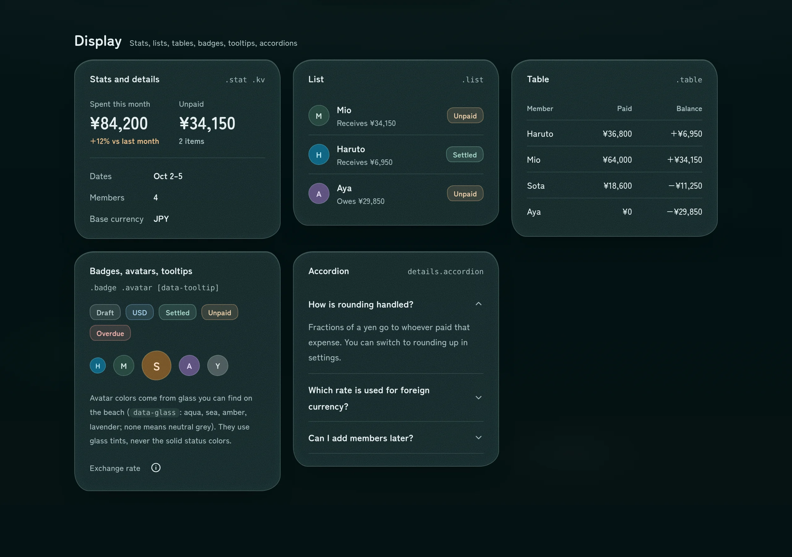
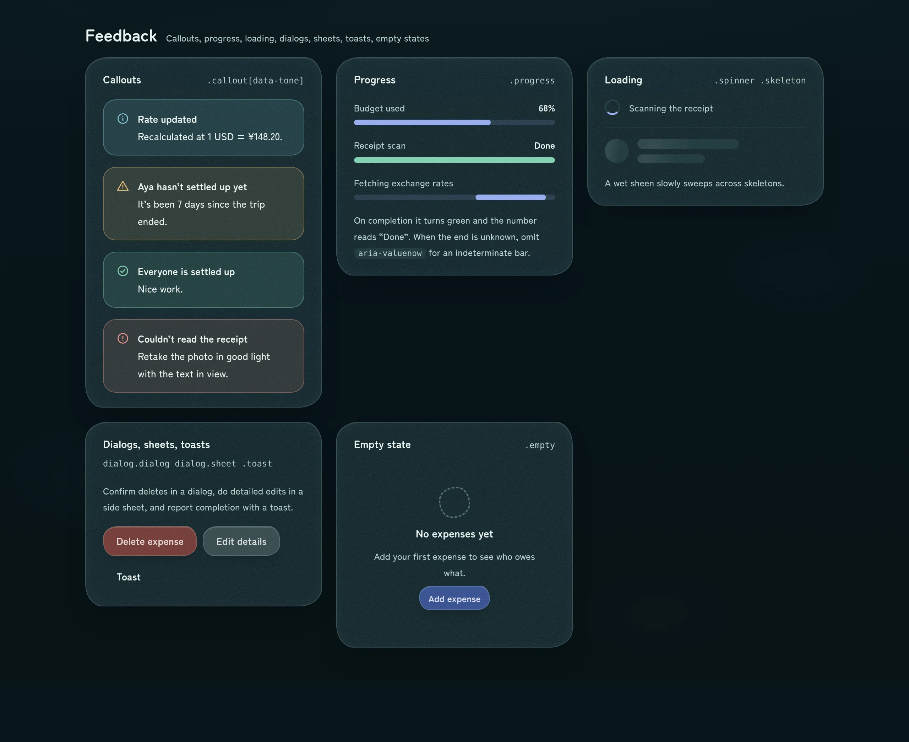

# Seaglass

**A frosted, tumbled-glass design system in plain CSS — written for humans and for AI coding agents.**

If Liquid Glass is a polished window, Seaglass is the shard you pick up on the beach: worn soft by the waves, frosted by the sand, letting light through without reflecting anything back.



- **One CSS file, no framework.** Tokens and component classes in `seaglass.css`, three tiny behaviors in `seaglass.js`. No build step, no dependencies.
- **Light and dark from the same tokens.** Every color is a `light-dark()` pair; the page follows the OS or a `data-theme` attribute.
- **Ships with an agent skill.** `skills/seaglass/` teaches Claude Code (or any agent that reads `SKILL.md`) the rules, the components and the don'ts, so generated UI stays on-brand without hand-holding.

## The idea in four rules

Every detail in Seaglass comes from one of these.

| | Rule | What it means in the UI |
|---|---|---|
| 1 | **Surfaces are frosted glass** | Cards, buttons, inputs, menus and dialogs blur what's behind them and carry a fine frost grain. Nothing shines while it's dry; only edges glow faintly. |
| 2 | **Corners are tumbled pebbles** | Radii are slightly uneven but point-symmetric, like glass rolled smooth by the sea. Boxes of running text keep even corners for readability. |
| 3 | **Rarity is importance** | On a real beach, white, green and brown glass are everywhere; cobalt is rare; red is rarest. So surfaces are sand and sea green, **cobalt means "you can act here"**, and **red only means danger**. Floating controls are tinted pieces of that glass, with text in a deeper shade of the same color. |
| 4 | **Touch makes it wet** | Hover clears the frost and slides a film of water over the glass. While you press a switch, a radio or a checkbox, its knob turns into a clear lens you can see through. |



<details>
<summary>Same, in dark mode</summary>



</details>

## Light and dark

The light theme is a shoreline at noon: shallow water fading into sand. The dark theme is the same beach at night, with heavier strokes so text stays legible on dark glass.

| Light | Dark |
|---|---|
|  |  |

<sub>The sample screen is a bill-splitting app for a trip, built only from Seaglass classes.</sub>

## Components

Everything a typical app needs, each with hover, focus, pressed, disabled and loading states where they apply.

| Group | Components |
|---|---|
| Basics | Type scale, links, inline code, `kbd`, dividers, layout helpers (`stack`, `row`, `grid`) |
| Actions | Buttons (primary, secondary, ghost, danger, small, icon, loading), popover menus, filter chips, removable tags |
| Inputs | Text, search, prefixed amount, textarea, select with a frosted picker, date, file dropzone, checkbox, radio, switch, range slider, floating input bar |
| Navigation | Sliding tabs, segmented control, side nav, breadcrumb, pagination |
| Display | Stats, key–value lists, lists, tables, badges, sea-glass avatars, tooltips, accordion |
| Feedback | Callouts, progress (determinate and indeterminate), spinner, skeleton, dialog, side sheet, toast with undo, empty state |






Open `catalog.html` in a browser to try them: theme switcher at the top, every component live. Motion only shows up there — the switch knob stretches as it travels, a checked box tumbles into place, the tab indicator springs between options.

## Quick start

```html
<link rel="preconnect" href="https://fonts.googleapis.com">
<link rel="preconnect" href="https://fonts.gstatic.com" crossorigin>
<link rel="stylesheet" href="https://fonts.googleapis.com/css2?family=Zen+Maru+Gothic:wght@400;500;700&display=swap">
<link rel="stylesheet" href="seaglass.css">
<script src="seaglass.js" defer></script>
```

```html
<div class="card stack">
  <div class="field">
    <label for="title">Title</label>
    <input class="input" id="title" placeholder="Dinner at the harbor">
  </div>
  <label class="switch"><input type="checkbox" role="switch" checked>Split evenly</label>
  <div class="row" data-justify="end">
    <button class="btn" data-variant="ghost">Cancel</button>
    <button class="btn" data-variant="primary">Add expense</button>
  </div>
</div>
```

- Force a theme with `<html data-theme="light">` or `data-theme="dark"`.
- If your framework renders tabs or sliders after load, call `seaglass.init(element)` once they're mounted.

## Using it with AI coding agents

Seaglass is meant to be written by agents as much as by people. The CSS is the single source of truth; the skill tells the agent how to use it and points back to the CSS instead of copying values.

```
seaglass/
├── seaglass.css              # tokens + components (source of truth)
├── seaglass.js               # tab indicator, range fill, motion replay
├── catalog.html              # every component, every state
└── skills/seaglass/
    ├── SKILL.md              # the four rules, which component to pick, don'ts
    └── references/
        ├── components.md     # markup for every component
        └── tokens.md         # token names and when to use them
```

**Claude Code:** copy or symlink the skill into your user or project skills.

```sh
ln -s "$PWD/skills/seaglass" ~/.claude/skills/seaglass
```

**In each app**, add one line to its `AGENTS.md` (or `CLAUDE.md`):

```md
UI uses Seaglass (seaglass.css). Follow the `seaglass` skill; don't write raw colors, radii or shadows.
```

The skill loads only when the agent works on UI, so it doesn't crowd out the rest of the context.

## Browser support

Built on current CSS: `light-dark()`, `backdrop-filter`, `@starting-style`, the Popover API and `linear()` easing. Recent Chrome, Edge, Safari and Firefox are all fine.

A few touches are progressive enhancements and fall back gracefully:

- The frosted select picker uses `appearance: base-select` (Chromium). Elsewhere you get the native list with a themed chevron.
- Menus anchor to their button with CSS anchor positioning; without it they open as a centered popover.
- The accordion animates its height with `::details-content` and `interpolate-size` (Chromium). Elsewhere it opens instantly.

`prefers-reduced-motion` turns animations off (spinners keep a slow turn so loading is still visible), and `prefers-reduced-transparency` swaps every frosted surface for an opaque one.
